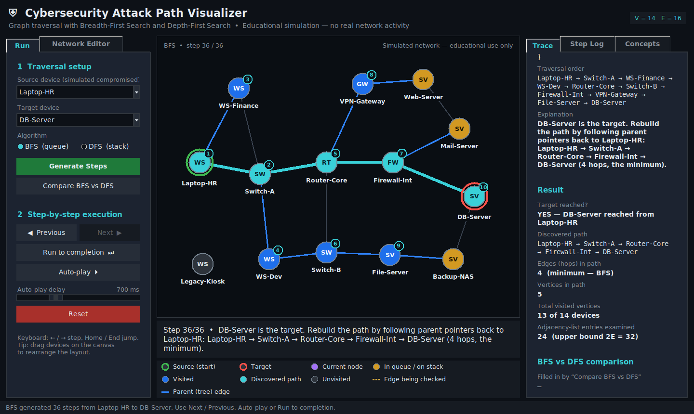
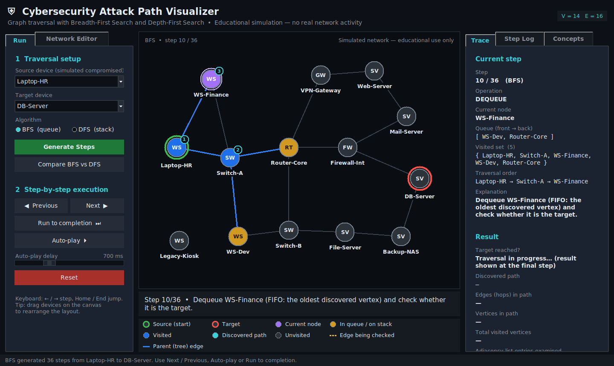
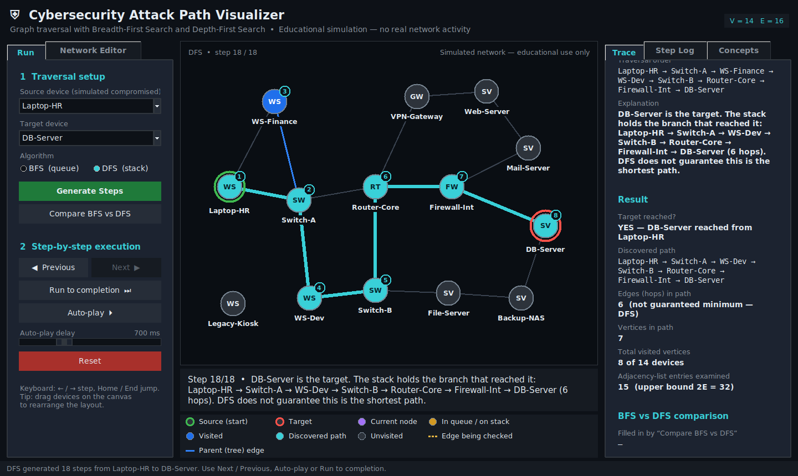
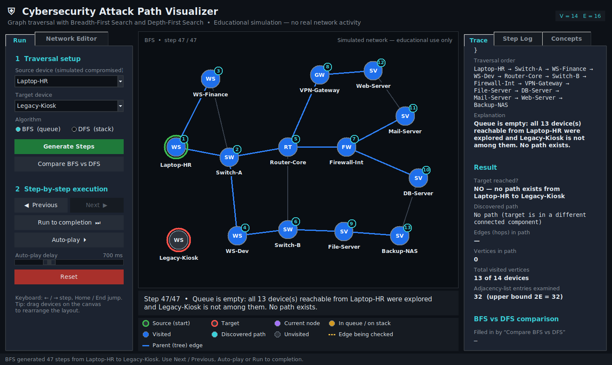
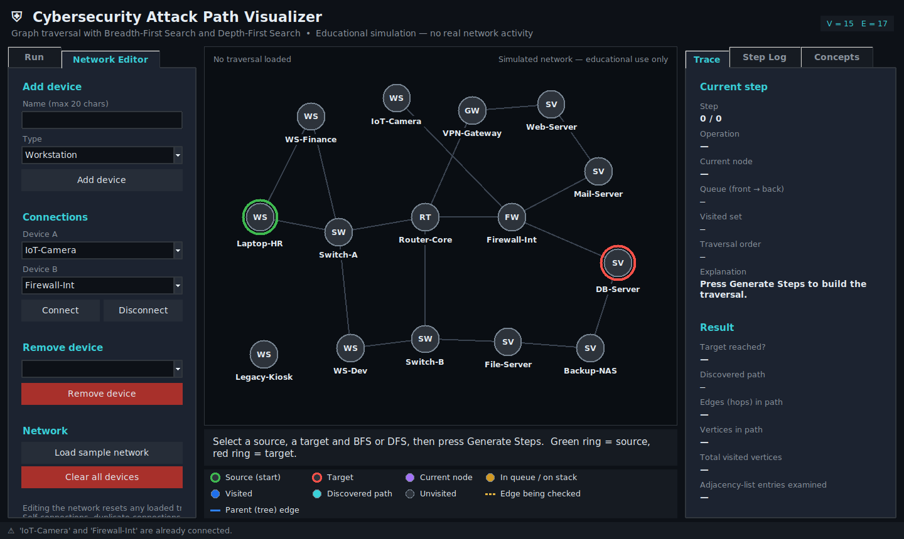

# Cybersecurity Attack Path Visualizer Using BFS and DFS

**Course:** Design and Analysis of Algorithms — Assignment 2 (GUI-Based Algorithm Implementation)

**Author:** ALBY MATHEW BIJU



A desktop application that models a small enterprise network as an undirected, unweighted graph and shows, step by step, how **Breadth-First Search (BFS)** and **Depth-First Search (DFS)** explore connectivity from a simulated compromised device to a target server.

> **Educational simulation only.** The "network" is a Python dictionary. The program performs no scanning, exploitation, credential attacks or network access of any kind.

---

## 1. Requirements

| Item | Requirement |
|---|---|
| Python | 3.10 or newer (the code is also compatible with 3.9) |
| GUI toolkit | Tkinter + ttk (included in the standard Windows installer from python.org) |
| External packages | **None** — standard library only, so there is no `requirements.txt` |
| Screen | 1280 × 720 or larger recommended (minimum window 1080 × 640) |

Check Tkinter is present:

```
python -m tkinter
```

A small test window should open. If it does not, re-run the Python installer, choose **Modify**, and tick **tcl/tk and IDLE**.

## 2. Run the application (Windows)

Open **Command Prompt** or **PowerShell** in the project folder:

```
cd path\to\AttackPathVisualizer
python attack_path_visualizer.py
```

If `python` is not recognised, use the Python launcher: `py attack_path_visualizer.py`.

## 3. Run the automated tests

```
python -m unittest -v
```

or `python test_attack_path_visualizer.py`. Expected result: **41 tests, OK**. The six GUI smoke tests open a hidden Tk window; on a machine with no display they are reported as *skipped* instead.

## 4. Project files

| File | Purpose |
|---|---|
| `attack_path_visualizer.py` | GUI application (Tkinter/ttk). Entry point. |
| `traversal_core.py` | Graph data structure, BFS, DFS, step recording, sample network. No GUI code. |
| `test_attack_path_visualizer.py` | 41 `unittest` tests (algorithms, boundary cases, editor validation, GUI smoke tests). |
| `test_results.txt` | Verbatim output of the test run performed before delivery. |
| `screenshots/` | Genuine screenshots of the running application (see note in §8). |
| `report.docx` | Formal academic report. |
| `MANUAL_TEST_CHECKLIST.md` | Checklist for verifying the GUI by hand on Windows. |

## 5. Using the application

**Run tab**

1. Choose a **Source device** (the simulated compromised host) and a **Target device**.
2. Choose **BFS** (queue) or **DFS** (stack).
3. Press **Generate Steps**.
4. Use **Next ▶ / ◀ Previous**, **Run to completion**, or **Auto-play** (adjust the delay slider). Keyboard: ← / → step, Home / End jump.
5. **Reset** clears the traversal. **Compare BFS vs DFS** runs both and summarises hop counts.

**Canvas** — green ring = source, red ring = target, purple = current node, amber = in queue / on stack, blue = visited, cyan = discovered path. The numbered badge on a node is its position in the traversal order. A dashed amber edge is the edge being checked; blue edges are parent (tree) edges. Devices can be dragged to rearrange the layout.

**Right panel** — *Trace* shows the step number, operation, current node, queue/stack contents, visited set, traversal order, an explanation and (at the final step) the result: target reached, path, hops, vertices in path, visited count and adjacency entries examined. *Step Log* lists every step (click a row to jump). *Concepts* explains BFS, DFS and their complexity.

**Network Editor tab** — add a device (name + type), connect / disconnect two devices, remove a device, reload the sample network or clear everything. Self-connections, duplicate connections (in either direction), duplicate names (case-insensitive), invalid names and more than 30 devices are rejected with a message. Any edit resets the loaded traversal.

### Suggested demonstrations with the sample network

| Source → Target | Algorithm | What it shows |
|---|---|---|
| Laptop-HR → DB-Server | BFS | Shortest path: 4 hops (via Router-Core and Firewall-Int), 36 steps |
| Laptop-HR → DB-Server | DFS | Valid but longer path: 6 hops (detours via WS-Dev and Switch-B), 18 steps |
| Laptop-HR → Legacy-Kiosk | either | Isolated device → explicit "no path" after exploring all 13 reachable devices |
| Laptop-HR → Laptop-HR | either | Source = target → one-node path, 0 hops |

## 6. Algorithms and complexity

Let **V** = number of vertices (devices) and **E** = number of edges (connections). The graph is stored as an adjacency list (`dict[str, list[str]]`).

| | Time | Auxiliary space |
|---|---|---|
| Graph storage | — | O(V + E) |
| BFS | O(V + E) | O(V) — queue, visited set, parent map |
| DFS (iterative) | O(V + E) | O(V) — stack, visited set, parent map, neighbour iterators |

*Why O(V + E):* each vertex is marked visited at most once, so it is enqueued/dequeued (BFS) or pushed/popped (DFS) at most once — O(V). Each processed vertex scans its own adjacency list once; in an undirected graph the lists contain 2E entries in total — O(E). The GUI's "adjacency-list entries examined" counter shows this directly (it never exceeds 2E).

*BFS shortest path:* the FIFO queue processes vertices in non-decreasing distance from the source, and a vertex's parent is fixed when it is first discovered, so the parent chain to the target has the minimum number of edges.

*DFS:* follows one branch as deep as possible and backtracks when stuck. It stops at the first path it finds, which need not be the shortest.

*Algorithm space vs GUI history:* for Previous/Next playback the program stores a snapshot after every elementary step. Each snapshot copies O(V) data and there are O(V + E) snapshots, so playback uses **O((V + E)·V)** extra memory. That cost belongs to the visualisation, not to BFS/DFS; calling `bfs(..., record_steps=False)` uses only the O(V) auxiliary space.

**Implementation notes.** BFS marks vertices visited when they are *enqueued* and tests for the target when a vertex is *dequeued*. DFS is iterative (explicit stack + one neighbour iterator per vertex), marks vertices visited when *pushed*, and stops as soon as the target is pushed — the stack then is the path. Neighbours are explored in insertion order, so results are deterministic. No graph library is used.

## 7. Known limitations

* Maximum 30 devices so the canvas stays readable; very dense graphs can still have crossing edges (devices can be dragged apart).
* Edited networks are not saved to disk; the sample network is reloaded on every start.
* The graph is unweighted and undirected, so it cannot model link cost, firewall direction rules or vulnerability severity.
* The step history stores full snapshots (see §6), which is fine at this scale but would not suit very large graphs.

## 8. Verification performed before delivery

* Syntax check (`py_compile`) and all 41 automated tests passed on Python 3.12 / Linux, both with a virtual display (all 41 run) and without one (35 run, 6 GUI tests skipped). See `test_results.txt`.
* The GUI was launched under a virtual X display (Xvfb) on Linux and driven through every feature; the screenshots in `screenshots/` are genuine captures of that run. Fonts differ slightly from Windows (DejaVu Sans instead of Segoe UI).
* **Not yet verified:** running on Windows itself. Please follow `MANUAL_TEST_CHECKLIST.md` once on your own computer before the demonstration.

## 9. More screenshots

| BFS in progress | DFS result |
|---|---|
|  |  |
| **No path (isolated device)** | **Network editor** |
|  |  |
